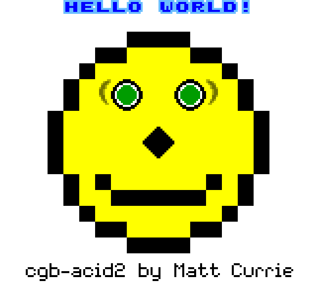
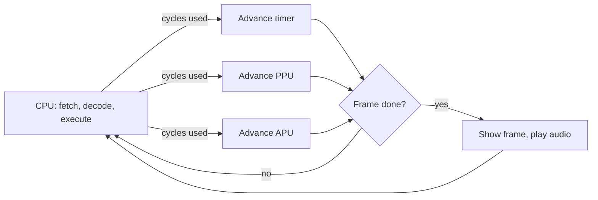
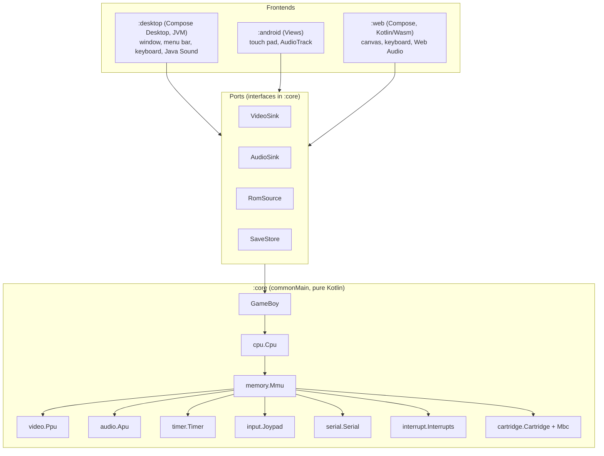
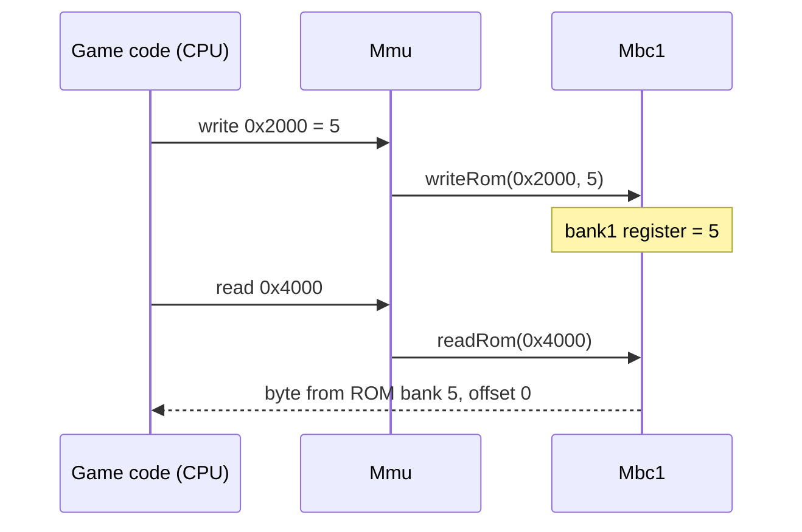
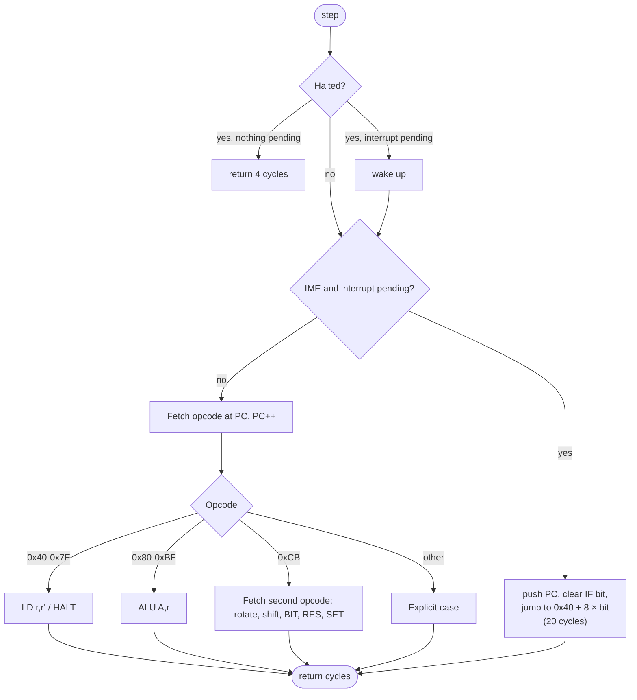
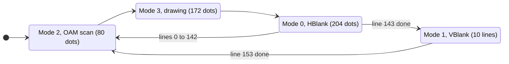
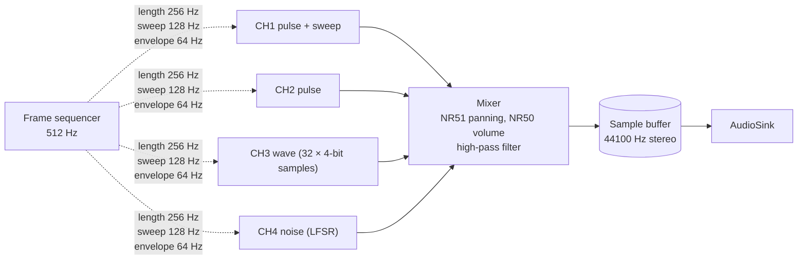
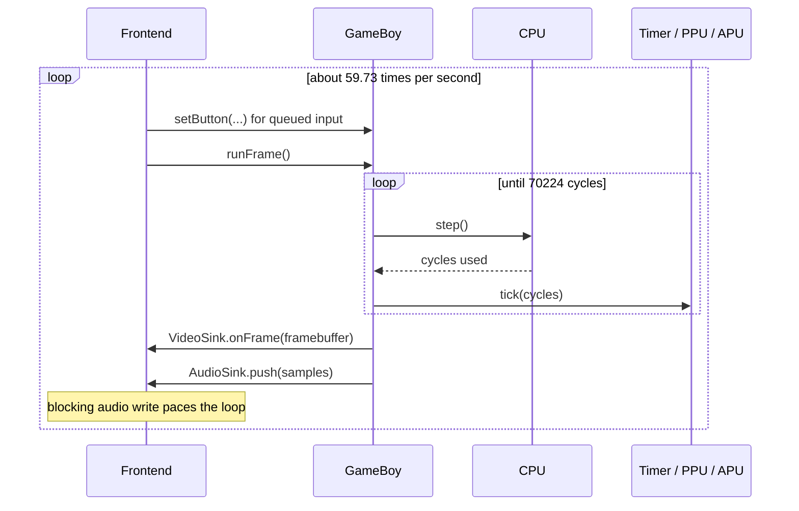

# KGameBoy

A Game Boy and **Game Boy Color** emulator written in **Kotlin Multiplatform**, built to learn how emulation works.
The emulator core is plain Kotlin with no platform code, and it runs on a **macOS/JVM desktop** app
and an **Android** app that share it unchanged.

<p align="center">
  
  <br>
  <em>KGameBoy running <a href="https://github.com/mattcurrie/dmg-acid2">dmg-acid2</a> (original Game Boy) and
  <a href="https://github.com/mattcurrie/cgb-acid2">cgb-acid2</a> (Game Boy Color), two PPU tests (headless screenshots, 4x).</em>
</p>

## Contents

1. [Quick start](#quick-start)
2. [What is emulation?](#what-is-emulation)
3. [Architecture](#architecture)
4. [Memory map](#memory-map)
5. [The cartridge and bank switching](#the-cartridge-and-bank-switching)
6. [The CPU](#the-cpu)
7. [Interrupts and the timer](#interrupts-and-the-timer)
8. [The PPU (video)](#the-ppu-video)
9. [The APU (sound)](#the-apu-sound)
10. [Input](#input)
11. [The main loop and timing](#the-main-loop-and-timing)
12. [Testing](#testing)
13. [ROMs and licenses](#roms-and-licenses)
14. [Project layout](#project-layout)
15. [Known limitations](#known-limitations)
16. [References](#references)

## Quick start

Requirements: JDK 17+. The Gradle wrapper downloads everything else. The Android app also needs the
Android SDK (a git-ignored `local.properties` with `sdk.dir=...` points Gradle at it).

```sh
# Desktop (macOS, Apple Silicon or Intel; also works on Linux/Windows)
./gradlew :desktop:run -Prom=roms/dmg-acid2.gb
./gradlew :desktop:run                      # no ROM given: native file dialog

# Render N frames without a window and save a 4x PNG (used for the screenshots here)
./gradlew :desktop:run -Prom=roms/dmg-acid2.gb -Pframes=120 -Pscreenshot=docs/img/out.png

# Unit and integration tests
./gradlew :core:allTests

# Web (Kotlin/Wasm in the browser): dev server with live reload, or a static bundle
./gradlew :web:wasmJsBrowserDevelopmentRun
./gradlew :web:wasmJsBrowserDistribution    # -> web/build/dist/wasmJs/productionExecutable

# Android debug APK -> android/build/outputs/apk/debug/android-debug.apk
./gradlew :android:assembleDebug
```

| Key | Game Boy |
|-----|----------|
| Arrow keys | D-pad |
| `X` | A |
| `Z` | B |
| `Enter` | Start |
| `Backspace` / `Shift` | Select |

The desktop app has a menu bar (in the macOS screen menu bar, or in the window on Windows/Linux):

| Menu | Items |
|------|-------|
| File | Open ROM… (`Cmd/Ctrl+O`), Close ROM (`Cmd/Ctrl+W`), Exit (Windows/Linux) |
| Emulation | Pause (`Cmd/Ctrl+P`), Reset (`Cmd/Ctrl+R`) |
| View | Virtual controller (on-screen Game Boy pad below the screen, clickable with the mouse), Window size 1x to 6x |
| Help | Controls, About |

On Android the same buttons are drawn on screen and support multi-touch.
Battery-backed saves are written to a `.sav` file next to the ROM (desktop) or to the app's private
storage (Android).

## What is emulation?

A console is a set of chips connected by a bus. To emulate it you model each chip as a piece of
**state** (registers, memory) plus a rule for how that state changes as time passes. The emulator
does not need to model transistors, only observable behavior: if every read and write the game
performs gets the same answer as on real hardware, at the same moment, the game cannot tell the
difference.

Three ideas carry almost all of the design:

1. **State + step.** The CPU is a loop: fetch an opcode, decode it, execute it. Each execution
   changes registers and memory. Everything else (video, sound, timers) is also "state + step".
2. **A shared clock.** The Game Boy runs at 4,194,304 cycles per second. The CPU reports how many
   cycles each instruction took, and every other component advances by that same number. That is
   how the picture, the sound and the program stay in sync without real threads.
3. **Memory-mapped I/O.** The CPU only knows how to read and write addresses. Hardware registers
   such as "LCD control" or "sound channel 1 volume" live at fixed addresses, so talking to
   hardware is just writing to memory. The address bus decides which component owns each address.



## Architecture

`:core` models the hardware and knows nothing about windows, speakers, keyboards or files. The
outside world is reached through small **ports** (interfaces); each platform implements them.



Each hardware block lives in its own package, mirroring the real machine:

| Package | Hardware | Main types |
|---------|----------|------------|
| `cartridge` | ROM, cartridge RAM, memory bank controller | `Cartridge`, `CartridgeHeader`, `Mbc` (`RomOnly`, `Mbc1`, `Mbc3`, `Mbc5`), `RomSource`, `SaveStore` |
| `cpu` | Sharp LR35902 processor | `Cpu` |
| `memory` | Address bus, work RAM, high RAM, OAM DMA | `Bus`, `Mmu` |
| `video` | Pixel Processing Unit, VRAM, OAM | `Ppu`, `VideoSink` |
| `audio` | Audio Processing Unit, 4 channels | `Apu`, `PulseChannel`, `WaveChannel`, `NoiseChannel`, `Envelope`, `AudioSink` |
| `input` | Joypad matrix | `Joypad`, `Button` |
| `timer` | DIV / TIMA timer | `Timer` |
| `interrupt` | IF / IE registers | `Interrupts` |
| `serial` | Link port | `Serial` |

The CPU talks only to the `Bus` interface. That is why `CpuTest` can run the processor against a
flat array of bytes with no other hardware attached.

## Memory map

The CPU has a 16-bit address space (64 KiB). `memory.Mmu` decodes each address and forwards the
access to the component that owns it.

| Range | Size | Contents | Owner |
|-------|------|----------|-------|
| `0000-3FFF` | 16 KiB | ROM bank 0 (fixed) | Cartridge |
| `4000-7FFF` | 16 KiB | ROM bank 1..N (switchable) | Cartridge / MBC |
| `8000-9FFF` | 8 KiB | Video RAM: tile data and tile maps | PPU |
| `A000-BFFF` | 8 KiB | External cartridge RAM (switchable) | Cartridge / MBC |
| `C000-DFFF` | 8 KiB | Work RAM | Mmu |
| `E000-FDFF` | ~8 KiB | Echo of work RAM | Mmu |
| `FE00-FE9F` | 160 B | Sprite attribute table (OAM) | PPU |
| `FEA0-FEFF` | 96 B | Unusable | Mmu |
| `FF00-FF7F` | 128 B | I/O registers | Joypad, serial, timer, APU, PPU, ... |
| `FF80-FFFE` | 127 B | High RAM | Mmu |
| `FFFF` | 1 B | Interrupt enable | Interrupts |

Important I/O registers:

| Address | Name | Component |
|---------|------|-----------|
| `FF00` | P1 (joypad) | Joypad |
| `FF01`, `FF02` | SB, SC (serial) | Serial |
| `FF04`-`FF07` | DIV, TIMA, TMA, TAC | Timer |
| `FF0F` | IF (interrupt flags) | Interrupts |
| `FF10`-`FF3F` | Sound registers and wave RAM | APU |
| `FF40`-`FF4B` | LCDC, STAT, SCY, SCX, LY, LYC, DMA, BGP, OBP0, OBP1, WY, WX | PPU / Mmu |

## The cartridge and bank switching

The CPU can only see 32 KiB of ROM, but cartridges hold up to several megabytes. A **memory bank
controller (MBC)** chip on the cartridge solves this: the game writes a bank number to an address in
the ROM area. Real ROM ignores writes, so the MBC intercepts them as register writes and swaps which
16 KiB bank appears at `4000-7FFF`.



`Cartridge.load()` reads the header at `0100-014F` and picks the right controller:

| Offset | Field | Used for |
|--------|-------|----------|
| `0134-0143` | Title | Window title |
| `0147` | Cartridge type | Selects `RomOnly` / `Mbc1` / `Mbc3` / `Mbc5` and whether RAM has a battery |
| `0148` | ROM size | Number of 16 KiB banks: `2 << code` |
| `0149` | RAM size | None, 8, 32, 128 or 64 KiB |
| `014D` | Header checksum | `x = x - byte - 1` over `0134-014C`; a mismatch is reported, not fatal |

| Controller | ROM banks | RAM | Notes |
|------------|-----------|-----|-------|
| `RomOnly` | 2 | optional | No banking |
| `Mbc1` | up to 128 | up to 32 KiB | Bank 0 is promoted to 1; mode bit changes how the 2-bit register is used |
| `Mbc3` | up to 128 | up to 32 KiB | Real-time clock registers (present, not ticking) |
| `Mbc5` | up to 512 | up to 128 KiB | Bank 0 is selectable |

A ROM is just a `ByteArray` to the core. A frontend implements `RomSource` (a file on desktop, a
document picked with the Storage Access Framework on Android), and `SaveStore` for battery RAM.

## The CPU

The Game Boy CPU is a Sharp **LR35902**, a hybrid of the Intel 8080 and Zilog Z80.

| Register | Notes |
|----------|-------|
| `A` | Accumulator |
| `F` | Flags: `Z` (bit 7), `N` (bit 6), `H` (bit 5), `C` (bit 4). Low nibble is always 0 |
| `B C D E H L` | General purpose, usable as pairs `BC`, `DE`, `HL` |
| `SP`, `PC` | Stack pointer and program counter |
| `IME` | Interrupt master enable (not addressable) |

`Cpu.step()` is one turn of this loop:



Design notes:

- The regular blocks are decoded from **bit fields** rather than 256 hand-written cases. In
  `0x40-0x7F` the destination register is bits 5-3 and the source is bits 2-0, using the index
  `B C D E H L (HL) A`. In `0x80-0xBF` bits 5-3 pick the ALU operation (`ADD ADC SUB SBC AND XOR OR CP`).
- Every instruction returns its length in **T-cycles** (always a multiple of 4). Conditional jumps
  return a different count when taken.
- **Half carry** (`H`) is the carry out of bit 3 (bit 11 for 16-bit adds); BCD correction (`DAA`) uses it.
- `EI` takes effect after the *next* instruction. `HALT` with IME off and an interrupt already
  pending reproduces the hardware "HALT bug" (the next byte is read twice).
- The DMG boot ROM is not emulated: registers start with the values it leaves behind
  (`PC=0100`, `SP=FFFE`, `AF=01B0`, ...).

## Interrupts and the timer

Five interrupt sources set a bit in `IF` (`FF0F`); a bit in `IE` (`FFFF`) enables it. When IME is on
and a source is both requested and enabled, the CPU services the lowest-numbered one.

| Bit | Source | Vector |
|-----|--------|--------|
| 0 | VBlank | `0040` |
| 1 | LCD STAT | `0048` |
| 2 | Timer | `0050` |
| 3 | Serial | `0058` |
| 4 | Joypad | `0060` |

**Timer.** `DIV` is the top byte of a free-running 16-bit counter that ticks every cycle. `TIMA`
increments on the *falling edge* of one bit of that counter, chosen by `TAC`:

| `TAC` bits 1-0 | Counter bit | Frequency |
|----------------|-------------|-----------|
| `00` | 9 | 4096 Hz |
| `01` | 3 | 262144 Hz |
| `10` | 5 | 65536 Hz |
| `11` | 7 | 16384 Hz |

When `TIMA` overflows it reloads from `TMA` and requests the timer interrupt. Writing `DIV` zeroes
the whole counter, which can itself create a falling edge, exactly as on hardware.

## The PPU (video)

The screen is 160 × 144 pixels with 4 shades. The PPU draws one scanline at a time; every line lasts
**456 dots** (T-cycles) and a frame has 154 lines, so a frame is **70,224 cycles ≈ 59.73 Hz**.



```
          |<------------------ 456 dots per line ------------------>|
 line   0 | OAM scan 80 | drawing ~172 |      HBlank ~204            |
 line   1 | OAM scan 80 | drawing ~172 |      HBlank ~204            |
   ...
 line 143 | OAM scan 80 | drawing ~172 |      HBlank ~204            |
 line 144 |                      VBlank (mode 1)                     |
   ...                    (10 lines, VBlank interrupt at line 144)
 line 153 |                      VBlank (mode 1)                     |
```

**Tiles.** Graphics are built from 8 × 8 tiles at **2 bits per pixel**: 16 bytes per tile, two
bytes per row. The first byte holds the low bit of each pixel and the second the high bit.

```
 row bytes: lo = 0x3C (00111100), hi = 0x7E (01111110)

 bit:      7 6 5 4 3 2 1 0
 lo:       0 0 1 1 1 1 0 0
 hi:       0 1 1 1 1 1 1 0
 colour:   0 2 3 3 3 3 2 0     (hi bit << 1 | lo bit)
```

**Layers**, all rendered per line in `Ppu.renderLine()`:

- **Background**: a 32 × 32 grid of tile numbers (a *tile map*), scrolled with `SCX`/`SCY` and
  wrapping at 256 pixels. Tile data is addressed either unsigned from `8000` or signed from `9000`
  (`LCDC` bit 4).
- **Window**: a second, non-scrolling background positioned by `WX`/`WY`, with its own line counter.
- **Sprites**: 40 entries in OAM (Y, X, tile, flags), 8 × 8 or 8 × 16, flippable, with two palettes
  and an optional "behind background" priority. At most 10 sprites are drawn per line; on DMG the
  sprite with the smaller X wins.
- **Palettes** `BGP`, `OBP0`, `OBP1` map a 2-bit colour index to one of four shades (a green ramp
  like the original LCD).

The finished 160 × 144 ARGB frame reaches the frontend through `VideoSink`. `STAT` interrupts use
the real "STAT line" rule: the four sources (LY = LYC, HBlank, VBlank, OAM scan) are ORed, and the
interrupt fires only when that line goes from low to high.

## The APU (sound)

Four channels are mixed to stereo:



| Channel | Source | Special features |
|---------|--------|------------------|
| 1 | Square wave, 4 duty cycles | Frequency sweep, volume envelope, length counter |
| 2 | Square wave, 4 duty cycles | Volume envelope, length counter |
| 3 | 32 four-bit samples from wave RAM `FF30-FF3F` | 4 output levels (mute, 100, 50, 25 %) |
| 4 | 15-bit linear feedback shift register | 7-bit "narrow" mode, volume envelope |

A **frame sequencer** ticks every 8192 cycles (512 Hz) through eight steps:

| Step | Length (256 Hz) | Sweep (128 Hz) | Envelope (64 Hz) |
|------|:---:|:---:|:---:|
| 0 | ✓ | | |
| 1 | | | |
| 2 | ✓ | ✓ | |
| 3 | | | |
| 4 | ✓ | | |
| 5 | | | |
| 6 | ✓ | ✓ | |
| 7 | | | ✓ |

The mixer takes one sample every `4194304 / 44100 ≈ 95` cycles, sums the enabled channels per side,
applies the master volume, and removes the DC offset of the unsigned DAC with a one-pole high-pass
filter. `Apu.drain()` hands the accumulated samples to the `AudioSink`.

## Game Boy Color

A cartridge that sets bit 7 of header byte `0143` (`80` = works on both, `C0` = Color only) switches
the whole machine into **CGB mode**; every other cartridge runs exactly like the original DMG, with
the green shades. Nothing in the hardware code is duplicated: the same `Cpu`, `Mmu`, `Ppu` and `Apu`
classes check one `cgb` flag, so the DMG tests keep guarding the shared behaviour.

| Feature | Registers | Where |
|---------|-----------|-------|
| Second VRAM bank (tile data and tile attributes) | `FF4F` VBK | `Ppu.vram` is 16 KiB; `Mmu` routes `8000-9FFF` by bank |
| Eight work RAM banks (bank 0 fixed, 1-7 at `D000`) | `FF70` SVBK | `Mmu.wramIndex` |
| Background palettes: 8 × 4 colours, RGB555 | `FF68` BCPS, `FF69` BCPD | `Ppu.bgPalette` |
| Sprite palettes: 8 × 4 colours, RGB555 | `FF6A` OCPS, `FF6B` OCPD | `Ppu.objPalette` |
| Tile attributes: palette, bank, X/Y flip, priority | second VRAM bank, same map address | `Ppu.renderLine` |
| Sprite attributes: palette 0-7, VRAM bank | OAM byte 3 | `Ppu.renderSprites` |
| HDMA: general purpose and one block per HBlank | `FF51`-`FF55` | `Mmu.writeHdma` |
| Double speed | `FF4D` KEY1 plus the `STOP` instruction | `Mmu.trySpeedSwitch`, `GameBoy.step` |

**Colour RAM.** Each colour is two bytes, `0bbbbbgggggrrrrr`. Writing `BCPD`/`OCPD` stores a byte at
the index in `BCPS`/`OCPS` (bits 0-5), and bit 7 of the index register makes it auto-increment, so a
whole palette can be loaded with a run of writes. The 5-bit channels are expanded to 8 bits for the
ARGB framebuffer.

**Tile attributes.** On CGB the background map has a twin in the second VRAM bank. For each map entry
that twin holds an attribute byte:

```
 bit 7   BG-over-sprites priority     bit 6   flip vertically    bit 5   flip horizontally
 bit 3   tile data VRAM bank          bits 2-0   palette number
```

**Priority.** On DMG the sprite with the smaller X wins. On CGB only the OAM index counts. LCDC bit 0
stops switching the background off and becomes a master priority switch: when it is 0, sprites are
always drawn on top; when it is 1, a sprite's own priority bit or the tile's priority bit can put the
background in front of any non-zero background colour.

**HDMA.** Writing `FF55` with bit 7 clear copies all requested 16-byte blocks at once (general purpose
DMA). With bit 7 set it copies one block every time a visible line enters HBlank, which is how games
stream tile data without tearing; clearing bit 7 again cancels it. `Ppu` reports each HBlank through a
small callback, so it does not know about DMA.

**Double speed.** A program writes bit 0 of `KEY1`, then executes `STOP`; the CPU toggles between
4.19 and 8.39 MHz. The CPU and the timer run twice as fast, while the PPU and APU keep their pace.
`GameBoy.step` therefore gives them half as many cycles, collected in multiples of 4 dots, and
`runFrame` counts dots (70224 per frame) instead of CPU cycles. Boot values follow the CGB boot ROM
(for example `A = 0x11`).

## Input

The joypad is a 2 × 4 matrix read through register `P1` (`FF00`). The game selects a row by writing a
**0** to bit 4 (directions) or bit 5 (buttons), then reads the four low bits, where **0 means
pressed**.

```
             bit 0   bit 1   bit 2   bit 3
 bit 4 = 0   Right   Left    Up      Down      (directions)
 bit 5 = 0   A       B       Select  Start     (buttons)
```

A line that falls on a selected row raises the joypad interrupt. Frontends only call
`GameBoy.setButton(button, pressed)`.

## The main loop and timing



Frontends do not sleep to hit 60 fps. Each frame produces about 738 audio sample-frames
(`70224 × 44100 / 4194304`), and the audio device consumes them at a fixed rate, so a
**blocking audio write** locks the emulator to real time. If no audio device exists, the desktop
app falls back to timed sleeping.

## Testing

`./gradlew :core:allTests` runs the suites below on the JVM, and the platform-independent ones (111 tests) again on Kotlin/Wasm under Node.js, which checks that the core behaves the same in the browser:

| Suite | What it checks |
|-------|----------------|
| `CartridgeTest` | Header parsing, checksum, truncated and invalid ROMs |
| `MbcTest` | Bank switching for MBC1/3/5, bank 0 promotion, RAM enable |
| `CpuTest` | Flags, ALU, 16-bit ops, stack, calls, conditional timing, DAA, CB opcodes, EI delay, interrupts, HALT |
| `TimerTest` | DIV rate, TIMA frequencies, overflow and interrupt |
| `JoypadTest` | Row selection, active-low logic, interrupt |
| `PpuTest` | Line and frame timing, modes, VBlank, STAT, tile decoding, scroll, palettes, sprites |
| `ApuTest` | Sample rate, channels, length counter, panning, power-off behaviour |
| `MmuTest` | Address routing, echo RAM, I/O registers, OAM DMA |
| `SerialTest` | Transfer and interrupt |
| `CgbTest` | CGB header flag, VRAM/WRAM banking, palette auto-increment, tile and sprite attributes, priority rules, general and HBlank HDMA, double speed |
| `RomIntegrationTest` | Blargg's `cpu_instrs` (all 11 sub-tests) and `instr_timing` run headless |

The ROM tests read the verdict from the **serial port**, which is how Blargg's ROMs print results, so
no screen is needed. They are skipped when the ROMs are not on disk (see below).

## ROMs and licenses

| ROM | Where | License |
|-----|-------|---------|
| `roms/dmg-acid2.gb` | Included | MIT (Matt Currie) |
| `roms/cgb-acid2.gbc` | Included | MIT (Matt Currie) |
| Blargg `cpu_instrs`, `instr_timing` | Not included: download into `roms/third-party/` | No clear redistribution license |

See [`roms/README.md`](roms/README.md) for the download command. Commercial games are not
distributed and must come from cartridges you own.

## Project layout

```
KGameBoy/
├── core/                      Platform-independent emulator (Kotlin Multiplatform)
│   └── src/
│       ├── commonMain/kotlin/dev/kgameboy/core/
│       │   ├── GameBoy.kt     Owns all components, runs the clock
│       │   ├── cartridge/     Cartridge, header, MBCs, RomSource, SaveStore
│       │   ├── cpu/           Cpu
│       │   ├── memory/        Bus, Mmu
│       │   ├── video/         Ppu, VideoSink
│       │   ├── audio/         Apu, channels, Envelope, AudioSink
│       │   ├── input/         Joypad
│       │   ├── timer/         Timer
│       │   ├── interrupt/     Interrupts
│       │   └── serial/        Serial
│       ├── commonTest/        Unit tests
│       └── jvmTest/           ROM integration tests
├── desktop/                   Compose Desktop frontend (macOS and other JVMs)
├── android/                   Android frontend (Views, AudioTrack)
├── web/                       Browser frontend (Compose Multiplatform, Kotlin/Wasm)
├── roms/                      Demo ROM and licenses
└── docs/img/                  Screenshots
```

## Known limitations

This is a learning project, so some hardware details are simplified:

- **Game Boy Color is supported, Super Game Boy is not.** Colour output uses a plain RGB555 to RGB888 expansion, without the colour correction a real CGB screen applies. A DMG-only cartridge keeps the green shades instead of getting the boot ROM's automatic colourisation. The speed switch and HDMA do not stall the CPU, and the CGB-only infrared port is absent.
- **Instruction-level timing.** A whole instruction runs, then the other components catch up. This
  passes `cpu_instrs` and `instr_timing` but not sub-instruction tests such as Mooneye's.
- **PPU:** a line is drawn at once when mode 3 ends (no mid-line register effects), mode-3 length is
  fixed, and VRAM/OAM are not locked during drawing.
- **OAM DMA** and general-purpose HDMA copy instantly instead of taking 160 cycles.
- **MBC3 real-time clock** registers exist but do not advance. MBC2 is not implemented.
- **APU** is not cycle-exact (no extra-length-clock quirks, no zombie-mode envelope).
- No boot ROM, no save states, no link cable.
- The Android app compiles and packages a debug APK but has not been exercised on a device.
- The web app runs the emulator on the page's single thread and paces it with `requestAnimationFrame`; audio is scheduled through Web Audio and starts after the first click or key press (browser autoplay rule). Battery saves are not persisted in the browser. An on-screen touch pad (D-pad, A, B, Select, Start) works with multi-touch, but its input was only checked visually, not by pressing keys.

## References

- [Pan Docs](https://gbdev.io/pandocs/): the community hardware reference
- [gbdev.io](https://gbdev.io/): tools, tutorials and the opcode table
- [Game Boy: Complete Technical Reference](https://gekkio.fi/files/gb-docs/gbctr.pdf) by Gekkio
- [Blargg's test ROMs](https://github.com/retrio/gb-test-roms) and [dmg-acid2](https://github.com/mattcurrie/dmg-acid2)
